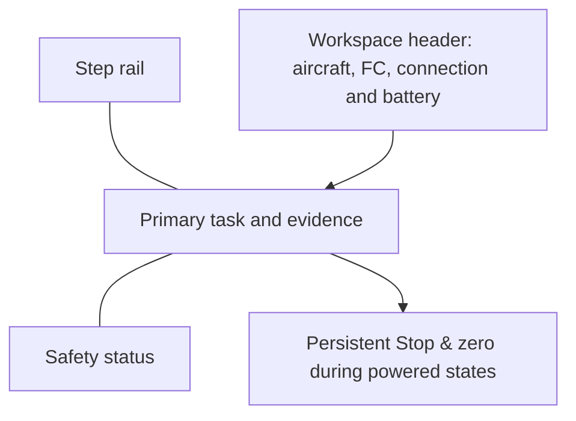
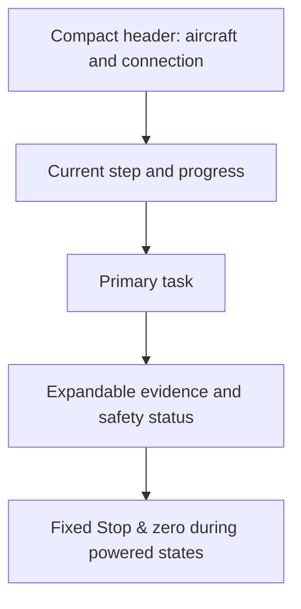

# UAV Companion Automated Motor Diagnostics

**Status:** For review  
**Date:** 2026-11-16  
**Scope:** Build requirements only; no implementation, commit, migration, push, or deployment is authorized.

## 1. Objective

Add a local-first diagnostic workflow that combines:

1. a propeller-free, low-output motor bench test using DShot telemetry and Blackbox data; and
2. analysis of a subsequent ordinary flight log with propellers installed.

The feature must identify repeatable anomalies, explain the supporting evidence, and recommend inspection. It must never certify an aircraft as safe or airworthy.

## 2. Agreed product decisions

- Initial firmware scope: Betaflight only.
- Initial aircraft scope: non-3D, four-motor DShot multirotors.
- Bidirectional DShot RPM telemetry is required for the active test. Extended DShot telemetry is optional.
- Active testing may ship without an FC-side stop-on-disconnect watchdog only with propellers removed, an immediately accessible battery plug, and a smoke stopper/current limiter.
- Desktop and Android support are both launch requirements. Unsupported devices must fail closed before any motor command.
- UAV Companion must not change Blackbox configuration. It must report incompatible settings and provide manual Betaflight setup instructions.
- Derived aircraft history is retained locally by default. Raw logs are retained only when the user opts in.
- No diagnostic data is uploaded or synced through Supabase in this scope.
- Existing Blackbox data is never erased automatically.
- The workflow uses a dedicated full-screen diagnostic workspace launched from the dashboard.
- After the flight battery is connected, normal exit is forbidden until zero output is commanded, zero RPM is verified, and battery disconnection is confirmed.
- Every motor sweep begins with a separate brief press-and-hold gesture, then runs as an automatic capped sequence.

## 3. Supported-environment gate

Before exposing active controls, the app must verify:

- a supported desktop or Android transport is available and permission was granted by a user gesture;
- the connected device identifies as a supported Betaflight FC and MSP API version;
- the mixer has exactly four motors;
- the motor protocol is DShot with working bidirectional RPM telemetry;
- 3D/reversible mode is off;
- the FC is disarmed and the transmitter arm switch is not active;
- Blackbox is enabled on usable storage with adequate free capacity;
- Blackbox records unfiltered gyro, motor output, and RPM at an effective rate of at least 1 kHz;
- the configured motor-pole count is present and plausible.

If a requirement fails, show the exact value found, the required value, and manual steps in Betaflight. Do not alter settings or enable motor commands.

Android and desktop must use the same protocol, state machine, limits, and analysis rules behind separate transport adapters where necessary. A narrowly scoped Android bridge is allowed if browser APIs cannot meet the launch requirement; it must not require a wider application rewrite.

## 4. Safety model

### 4.1 Mandatory physical preparation

Require a fresh acknowledgement that:

- every propeller has been physically removed;
- the aircraft is secured on a clear, nonconductive bench;
- loose wires and objects are clear of the motors;
- the battery plug is unobstructed and within immediate reach;
- a smoke stopper/current limiter is installed;
- the arm switch is off and throttle is at minimum.

Each motor sweep requires a separate user start action. The workflow must never run unattended and must never command multiple motors simultaneously.

### 4.2 Known residual risk

Stock `MSP_SET_MOTOR` does not provide a dependable motor-output timeout. A browser crash, USB loss, OS termination, or transport failure may prevent a zero command from reaching the FC. The guaranteed emergency action is physical battery disconnection. This limitation must appear immediately before testing and in the final report.

### 4.3 Software interlocks

- All motor commands go through one allowlisted motor-test state machine.
- Nonzero commands are forbidden outside the active `RUNNING` state.
- Starting or reconnecting always sends zero output before other motor commands.
- Any cancellation, timeout, stale telemetry, invalid frame, visibility loss, focus loss, over-temperature, unexpected RPM, voltage fault, arming change, or transport error triggers repeated zero commands and locks the session.
- A serial disconnect must immediately show: **Disconnect the flight battery now.**
- After a fault, require battery removal, FC reconnection, and a new zero-output verification.
- No master slider, free-form output field, CLI access, or command above the defined cap is permitted.

## 5. Bench-test flow

1. Connect the FC by USB with the flight battery disconnected.
2. Complete the supported-environment and Blackbox gates.
3. Complete the physical-preparation acknowledgement.
4. With USB power only, send zero to all motors, receive a valid MSP acknowledgement, and confirm the application's commanded state is zero. This is a software safe-state initialization; it does not claim physical zero RPM while the ESCs are unpowered.
5. Ask the user to connect the smoke stopper and flight battery.
6. After battery detection and ESC initialization, perform a powered-zero verification: confirm every motor remains stationary and every reported RPM value is zero, then record baseline voltage, telemetry errors, and available ESC temperatures.
7. Test one motor at a time:
   - begin at external output `1020`;
   - increase by `5` every 300–500 ms;
   - never exceed `1100`;
   - declare reliable rotation only after at least one second of continuous valid RPM, no zero-RPM dropout, no other motor rotating, and DShot errors below 1%;
   - record the first reliable output;
   - run the diagnostic plateau at the highest motor start threshold plus `15–20`, capped at `1100`, for no more than two seconds;
   - return all motors to zero and verify zero RPM before continuing;
   - repeat each motor once after a pause.
8. Abort rather than raise the cap if a motor is not stable by `1100`.
9. Send repeated zero commands, verify zero RPM, and require flight-battery disconnection before leaving bench mode.

## 6. Bench analysis

Use DShot telemetry and high-rate Blackbox data together to calculate:

- start-output threshold and repeatability per motor;
- RPM stability, acceleration, stopping response, and dropouts;
- DShot error rate and telemetry availability;
- ESC temperature, voltage, and current where available;
- unfiltered gyro RMS;
- vibration energy at each motor's rotational frequency and harmonics;
- comparison against peer motors at matched RPM;
- comparison against the aircraft's previous local baseline.

The analysis may identify an abnormal motor/ESC channel or RPM-correlated vibration. It must not claim that a bell, shaft, bearing, ESC, or mounting component is definitively defective.

## 7. Transition to flight

Flight-log collection is offered only if no stop-level bench anomaly exists.

Before propellers are installed, the app must confirm:

- all RPM values are zero;
- the flight battery is disconnected;
- the motor-test session is closed and cannot issue further output;
- Blackbox remains in the user's already-compatible normal flight configuration;
- sufficient recording capacity remains.

If capacity is insufficient, instruct the user to download existing logs and erase storage manually in Betaflight. UAV Companion must not erase it in this release.

## 8. Flight-log capture

The default instruction is:

> Fly normally in a safe open area. If comfortable, include approximately five seconds of steady hover after takeoff and before landing. Do not attempt unfamiliar manoeuvres for this test.

Support ordinary circuits and spontaneous freestyle. Do not require full-throttle runs or a prescribed manoeuvre sequence. After landing, the user reconnects the FC and selects or downloads the new flight log.

## 9. Flight-log analysis

Automatically validate the log, then classify usable windows such as:

- hover-like or otherwise steady flight;
- low-, medium-, and high-RPM operation;
- smooth acceleration;
- hard manoeuvres and propwash;
- motor saturation;
- takeoff, landing, impacts, and unusable/corrupted data.

Analyse matched windows rather than one whole-flight spectrum. Use RPM-normalised order tracking at 1x, 2x, and 3x motor rotational frequency, plus:

- per-motor RPM response and telemetry loss;
- unfiltered and filtered gyro noise;
- D-term amplification and motor-command oscillation;
- fixed-frequency frame resonance;
- voltage sag versus measured current where a calibrated physical sensor exists;
- ESC temperature/current where available;
- bench-versus-flight and historical-baseline differences.

If coverage is inadequate, report which conclusions are unavailable and what optional, comfortable flight segment would improve them. Never convert missing evidence into a pass.

## 10. Results and retention

Use four result levels:

- **No anomaly detected**
- **Monitor**
- **Inspection recommended**
- **Stop: do not continue testing**

Every finding must include the observed signal, affected motor/system, repetition count, operating range, plausible causes, next inspection step, confidence, and limitations.

Store locally by aircraft profile:

- FC/firmware and relevant motor/telemetry configuration;
- derived bench and flight metrics;
- trend history and report summaries;
- raw Blackbox logs only after explicit opt-in, with per-log deletion controls.

Provide export of the report and raw log for advanced review in the Betaflight App. Do not reproduce Betaflight's full graphing, playback, tuning, or configuration interface.

## 11. UI and interaction specification

### 11.1 Experience principles

- Launch from a dashboard **Check aircraft** action into a dedicated full-screen workspace.
- Present one primary task per screen with plain-language guidance and progressive disclosure for technical evidence.
- Keep aircraft identity, FC connection, battery state, safety state, and progress visible throughout the workflow.
- Remove map controls, general navigation, and unrelated actions while powered testing is active.
- Never use colour, sound, or vibration as the only carrier of safety or diagnostic meaning.
- Desktop and Android must preserve the same task order, safeguards, terminology, result levels, and emergency actions.

### 11.2 Workspace navigation and responsive shell

Before the flight battery is connected, the user may revisit completed setup steps. After battery detection, back, close, browser navigation, and ordinary workspace exit are intercepted until the system has commanded zero, verified zero RPM, and the user confirms battery disconnection. A fault replaces normal navigation with the locked emergency state.

Desktop layout:



Android layout:



On desktop, use a persistent step rail and a separate safety-status region. On Android, collapse these into a compact progress header and expandable status drawer. Primary controls must remain reachable without horizontal scrolling. The emergency action must remain visible above browser or device navigation areas.

### 11.3 Screen requirements

| Screen | Primary content and actions | Required behaviour |
| --- | --- | --- |
| Dashboard entry | **Check aircraft** card plus any **Resume flight analysis** session | A pending card shows aircraft, bench result, date, and missing flight-log status. |
| Connect aircraft | USB permission, detected FC, suggested aircraft profile, **Create profile** | Suggest a profile from stable FC identifiers/configuration fingerprints and require confirmation. Ambiguity must not attach history to the wrong aircraft. |
| Compatibility check | Blocking checklist with passed, warning, and failed rows | Failed rows expand to show detected value, required value, why it matters, and manual Betaflight steps. Provide **Recheck**; never alter FC settings. |
| Safety preparation | Individual physical-preparation checkboxes | Require a press-and-hold final confirmation. It expires after reload, FC reconnect, or a locked fault. |
| Safe-state and power | USB-only safe-state result, connection instructions, battery/ESC detection | Clearly distinguish commanded software zero from powered physical zero RPM. Keep the battery plug and smoke stopper instructions visible. |
| Powered-zero verification | Four motor indicators, RPM, voltage, telemetry errors, available temperatures | Any rotation produces an immediate stop/lock instruction. Continue only after all motors remain stationary and report zero RPM. |
| Active motor test | Top-down quad with active motor highlighted; active RPM, command, telemetry quality, timer; compact zero indicators for other motors | Require a brief press-and-hold to start each automatic sweep. Show essential readings by default; gyro, temperature, spectrum, and raw details are expandable. |
| Stop and emergency | Persistent red **Stop & zero** action | One tap, no confirmation. Send repeated zero, verify RPM where possible, and require battery disconnection before exit. |
| Bench result | Plain-language overall level and colour-coded, labelled quad diagram | Selecting a motor expands measurements, peer/baseline comparison, confidence, limitations, and inspection steps. Block the flight path after a stop-level finding. |
| Flight handoff | Flight instructions and **Finish bench session** | Close motor-control capability, verify zero, confirm battery removal, and save a pending diagnostic session. |
| Resume and log selection | Suggested new Blackbox log with time/order, duration, size, and match rationale | Require confirmation. Label uncertainty and allow selection of another available log; never silently analyse a guessed match. |
| Combined report | One combined conclusion with expandable **Bench evidence** and **Flight evidence** | Explicitly show agreement, contradiction, missing coverage, confidence, and next action. Do not average incompatible evidence into a score. |
| Aircraft history | Aircraft-specific diagnostic timeline and trends | Reachable from the latest result and dashboard aircraft card. Show finding level, affected motors, coverage, baseline changes, and raw-log retention independently. |

### 11.4 Active-test interaction rules

- A top-down quad diagram identifies the motor position before each sweep.
- The user briefly presses and holds **Test motor N** to begin; releasing before the hold completes cancels without commanding nonzero output.
- After initiation, the sweep is automatic, capped, timed, and governed by the shared safety state machine.
- **Stop & zero** is persistent, red, and actionable with one tap. It must not be hidden inside a menu or confirmation dialog.
- Other motors remain visible as compact zero-RPM indicators. Unexpected peer-motor RPM immediately aborts and locks the session.
- Live defaults are commanded output, RPM, telemetry quality, elapsed time, current step, and connection/battery state. Advanced telemetry is expandable and must not displace the emergency action.

### 11.5 Fault and attention behaviour

Critical conditions replace the workspace with a full-screen instruction. USB loss or loss of command confirmation during a powered state must lead with **Disconnect the flight battery now.** Where supported, also trigger vibration and a short alert tone. The message must remain understandable with audio disabled, haptics unavailable, or colour perception impaired.

The locked screen must state:

1. what was detected;
2. the immediate physical action;
3. whether software zero was confirmed or could not be confirmed;
4. the required recovery sequence: remove battery, reconnect FC, repeat safe-state and powered-zero verification.

### 11.6 Result, history, and retention UI

- Use the four agreed finding levels as text labels with distinct icons and colours.
- Lead with a layman summary, affected motor/system, confidence, and next inspection action.
- Use the quad diagram as the primary motor locator; technical plots and tables remain expandable.
- Save derived history automatically to the confirmed aircraft profile.
- After analysis, show an off-by-default **Keep raw log** toggle with raw-file size and a clear explanation that deleting the raw log does not remove derived history.
- Allow individual deletion and export of retained raw logs without deleting the diagnostic report.

### 11.7 UI state and navigation table

| State | Nonzero output allowed | Normal exit | Primary UI |
| --- | ---: | --- | --- |
| `DISCONNECTED` | No | Yes | Connect aircraft |
| `READINESS_BLOCKED` | No | Yes | Blocking checklist and manual fixes |
| `SAFE_IDLE` | No | Yes | USB-only safe-state initialization |
| `READY_TO_POWER` | No | Yes | Safety acknowledgement and battery instructions |
| `POWERED_ZERO` | No | No | Four-motor zero verification and Stop & zero |
| `MOTOR_READY` | No | No | Highlighted motor and hold-to-start control |
| `RUNNING` | One motor only | No | Live active-motor view and persistent Stop & zero |
| `VERIFY_ZERO` | No | No | Repeated zero commands and RPM verification |
| `LOCKED` | No | No | Full-screen battery-disconnect and recovery instructions |
| `BENCH_COMPLETE` | No | After confirmed battery removal | Bench result and optional flight handoff |
| `PENDING_FLIGHT` | No motor session exists | Yes | Dashboard Resume flight analysis card |
| `ANALYSING` | No motor session exists | Yes | Log validation, coverage, and analysis progress |
| `COMPLETE` | No motor session exists | Yes | Combined report and aircraft history |

### 11.8 Accessibility and content requirements

- Maintain at least 44 by 44 CSS pixel touch targets and visible keyboard focus.
- Provide logical keyboard and screen-reader order matching visual workflow order.
- Announce state transitions, motor identity, test start/stop, zero verification, and critical faults through accessible live regions without flooding telemetry updates.
- Pair every icon and colour with text. Graphs require summaries and accessible values.
- Critical controls must remain usable at 200% zoom and with Android font scaling.
- Use short sentences and explain MSP, DShot, RPM, telemetry, and confidence inline on first use.
- Do not use celebratory language or a green **Safe to fly** result. The most positive label remains **No anomaly detected**.

## 12. Architecture fit

Suggested ownership:

```text
src/preflight/
  transport.js       desktop/Android transport adapters
  msp-codec.js       minimal allowlisted MSP v1/v2 messages
  fc-session.js      connection, timeouts, zeroing, state machine
  readiness.js       firmware, DShot and Blackbox gates
  bench-test.js      adaptive per-motor sequence
  blackbox.js        independently implemented minimal decoder
  analysis.js        pure metrics, segmentation and comparisons
  history.js         versioned local aircraft profiles
  preflight-ui.js    guided workflow and reports
```

Entry point: a dashboard **Check aircraft** workflow, not the map's **More tools** menu. The feature remains guest-capable and local-first.

Do not copy GPL-3.0 Betaflight App or Blackbox Viewer source into the MIT-licensed UAV Companion repository. Use documented protocols/formats, original implementation, and compatible test fixtures.

## 13. Verification requirements

### Automated

- MSP framing, parsing, compatibility, corruption, and timeout tests.
- State-machine proof that nonzero output is impossible outside `RUNNING`.
- Command-cap, one-motor-only, duration, zeroing, and lockout tests.
- Mock disconnect/crash/visibility/telemetry-loss scenarios.
- Blackbox decoding, sample-rate validation, segmentation, order tracking, and confidence tests using synthetic and recorded fixtures.
- Local-history versioning, raw-log opt-in, deletion, export, and no-network tests.
- Desktop and Android UI/accessibility/responsive coverage.
- Screen-state tests proving powered navigation cannot bypass zero verification and battery-removal confirmation.
- Visual regression coverage for desktop and Android workspace layouts, emergency state, quad status, expanded compatibility fixes, and report states.
- Accessibility tests for focus order, live-region announcements, non-colour meaning, font scaling, and emergency-control reachability.

### Hardware matrix

- At least two supported Betaflight FC families and two DShot ESC firmware families.
- Desktop Chrome/Edge on supported operating systems.
- At least two representative Android devices using the production transport.
- USB removal during every bench-test state, including while output is nonzero.
- Battery removal, smoke-stopper operation, reconnect, stale telemetry, and app termination recovery.
- Healthy craft plus controlled known-fault fixtures; do not create unsafe faults on a flyable aircraft.

## 14. Delivery phases

1. **Transport and safety spike:** desktop/Android connectivity, MSP handshake, zero command, disconnect behaviour; development rig only.
2. **Read-only readiness:** firmware, DShot, Blackbox, storage, battery and telemetry validation.
3. **Bench prototype:** adaptive capped motor sequence and local capture; not public until hardware/failure testing passes.
4. **Bench analysis:** DShot plus Blackbox comparison and evidence report.
5. **Flight analysis:** import/download, automatic segmentation, bench comparison and confidence reporting.
6. **Local history and UX:** trends, optional raw logs, export, accessibility, manual setup guidance.
7. **Release review:** hardware matrix, residual-risk acceptance, documentation, privacy and production authorization.

## 15. Acceptance criteria

The backlog is complete only when:

- both desktop and Android launch gates pass on the documented hardware matrix;
- no unsupported configuration can reach a nonzero motor command;
- every normal software abort reaches verified zero RPM;
- disconnect limitations and physical cutoff actions are prominent and tested;
- the dedicated workspace, responsive layouts, compatibility checklist, safety confirmation, active-motor view, emergency state, result summary, pending-session handoff, and aircraft history satisfy the UI specification;
- bench and flight reports distinguish evidence, inference, uncertainty, and unavailable data;
- Blackbox settings and existing logs are never altered or erased by the feature;
- all data stays local unless the user explicitly exports it;
- no result claims the aircraft is safe to fly;
- relevant unit, browser, hardware, documentation, and privacy checks pass;
- implementation, commit, push, and deployment receive separate owner authorization.

## References

- [Betaflight Motors tab](https://betaflight.com/docs/wiki/app/motors-tab)
- [Betaflight MSP protocol reference](https://betaflight.com/docs/development/MSP-Protocol-Reference-Dev)
- [Betaflight Blackbox logging](https://betaflight.com/docs/wiki/guides/current/Black-Box-logging-and-usage)
- [Betaflight Blackbox internals](https://betaflight.com/docs/development/Blackbox-Internals)
- [Betaflight DShot RPM filtering](https://betaflight.com/docs/wiki/guides/current/DSHOT-RPM-Filtering)
- [Chrome Web Serial documentation](https://developer.chrome.com/docs/capabilities/serial)

