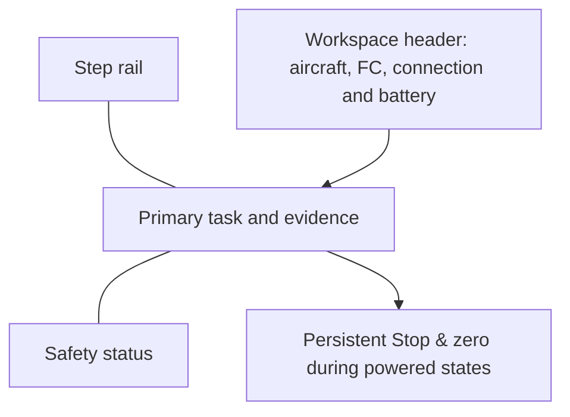
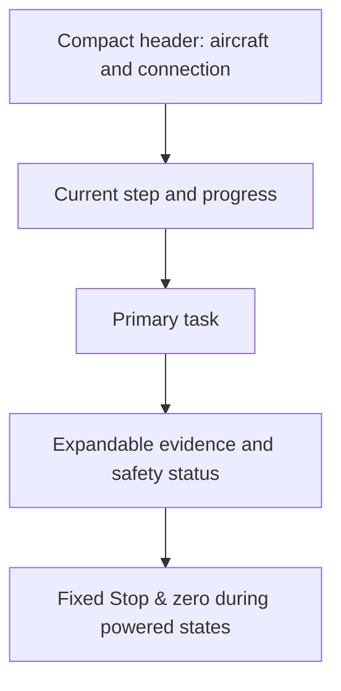

# UAV Companion Automated Motor Diagnostics

**Status:** In progress. Phase 0 done; Phase 1 and Phase 2 (read-only, flag off) authorized 2026-11-16. Phase 3 is **not** authorized.
**Date:** 2026-11-16
**Authoritative:** This document is the **sole authoritative build specification**. It supersedes [Addendum 1](UAV_COMPANION_MOTOR_DIAGNOSTICS_ADDENDUM_1.md), which is kept only as decision history (the owner approved it with corrections on 2026-11-16 and it is merged here). The [Phase 0 research](UAV_COMPANION_MOTOR_DIAGNOSTICS_PHASE0_RESEARCH.md) is evidence (finding IDs F1 to F25), not specification.
**Related:** [Active handoff](../../handoffs/active/MOTOR_DIAGNOSTICS_PHASE1_2_HANDOFF.md) · [Hazard analysis (Phase 3 entry gate)](../../MOTOR_DIAGNOSTICS_HAZARD_ANALYSIS.md)
**Authorization:** Documentation, Phase 1 and Phase 2 read-only implementation, commit and push to `main`. No deployment. No motor command, CLI access, configuration write, log erasure, reflashing, 4-way interface or Phase 3 work. Each of those, and any deployment, needs separate owner authorization.

## Status history

| Date | Event |
| --- | --- |
| 2026-11-16 | Backlog drafted (for review). |
| 2026-11-16 | Phase 0 research and Addendum 1 drafted; owner review requested revisions 1 to 8 (applied). |
| 2026-11-16 | Owner approved Addendum 1 with corrections. Merged into this document; addendum superseded. Moved to `in-progress/`. Phases 1 and 2 authorized (read-only). |

## Tags

**[SRC]** supported by a primary source (research finding ID). **[DEC]** owner decision. **[PROV]** provisional value, needs measurement before release. **[RES]** contradiction resolved. **[AC]** acceptance-criteria change.

## Product wording and ownership [DEC]

- The owner is the **provisional product-wording owner**. Legal review of wording is a separate pre-release decision and is not done.
- No UI, report, export or document may claim "safe to fly", airworthiness, certification, guaranteed fault detection or a definitive component diagnosis. The most positive label is **No anomaly detected**.
- **An aircraft that fails the compatibility gates is a normal, supported inventory outcome.** It is recorded with the exact detected and required values and the manual steps, and is not treated as an error.

## 1. Objective

Add a local-first diagnostic workflow that combines:

1. a propeller-free, low-output motor bench test using DShot telemetry and Blackbox data; and
2. analysis of a subsequent ordinary flight log with propellers installed.

The feature must identify repeatable anomalies, explain the supporting evidence, and recommend inspection. It must never certify an aircraft as safe or airworthy.

## 2. Agreed product decisions

- Initial firmware scope: Betaflight only.
- Initial aircraft scope: non-3D, four-motor DShot multirotors.
- Bidirectional DShot RPM telemetry is required for the active test. Extended DShot telemetry is optional.
- Active testing may ship without an FC-side stop-on-disconnect watchdog only with propellers removed, an immediately accessible battery plug, and a smoke stopper/current limiter.
- Desktop and Android support are both launch requirements. Unsupported devices must fail closed before any motor command.
- UAV Companion must not change Blackbox configuration. It must report incompatible settings and provide manual Betaflight setup instructions.
- Derived aircraft history is retained locally by default. Raw logs are retained only when the user opts in.
- No diagnostic data is uploaded or synced through Supabase in this scope.
- Existing Blackbox data is never erased automatically.
- The workflow uses a dedicated full-screen diagnostic workspace launched from the dashboard.
- After the flight battery is connected, normal exit is forbidden until zero output is commanded, zero RPM is verified, and battery disconnection is confirmed.
- Every motor sweep begins with a separate brief press-and-hold gesture, then runs as an automatic capped sequence.
- Desktop and Android are joint public-launch requirements. Desktop development may continue internally; the feature does not ship desktop-only without a new owner decision. [DEC]
- Empirical anomalies never produce **Stop** in the first release; only deterministic safety conditions do (section 17). [DEC]
- No 4-way interface access and no ESC configuration or flashing in this scope. The ESC firmware family is a manual inventory field (section 18). [DEC]
- Controlled fault collection is limited to contained, non-flying fixtures or naturally failed or retired components. A flyable aircraft is never modified to create damage. [DEC]

## 3. Supported-environment gate

Before exposing active controls, the app must verify (sources and versions in sections 19 and 20):

- a supported desktop or Android transport is available and permission was granted by a user gesture;
- the connected device identifies as `BTFL` with an exact firmware version and MSP API pair on the allowlist (section 19); anything else fails closed;
- the mixer has exactly four motors;
- the motor protocol is DShot with working bidirectional RPM telemetry (the flag is a hint; working RPM is proven by live RPM);
- 3D/reversible mode is off;
- the FC is disarmed (`ARMED` false), the ARM box state is inactive, and the user acknowledges the transmitter arm switch is off (the `ARM_SWITCH` arming-disable flag alone cannot prove this [SRC F15]);
- Blackbox is enabled on usable storage with adequate free capacity;
- **Blackbox mode** is `MOTOR_TEST` (preferred for the bench) or `ALWAYS`. These are the CLI-compatible tokens `NORMAL`, `MOTOR_TEST` and `ALWAYS`. The internal enum name `BLACKBOX_MODE_ALWAYS_ON` appears in no parser or user-facing text, and `ALWAYS_ON` is never a token. `NORMAL` logs only while armed and fails the bench gate [SRC F5, F6];
- Blackbox records unfiltered gyro, motor output and RPM: firmware 4.5 and newer need `gyroUnfilt` not disabled in the field mask; `MOTOR` and `RPM` must not be disabled; the log header must list the pole count [SRC F8, F10];
- the configured logged rate meets the 1 kHz sanity floor; analysis validity is decided per window (section 23);
- the configured motor-pole count is present and plausible (6..28, provisional).

If a requirement fails, show the exact value found, the required value, and manual steps in Betaflight. Do not alter settings or enable motor commands.

Android and desktop must use the same protocol, state machine, limits and analysis rules behind separate transport adapters where necessary.

**Android boundary [DEC]:** native Web Serial on Chrome for Android is the first path (Chrome 148 and newer; device coverage unproven [SRC F18]). A transport-only Capacitor / `usb-serial-for-android` prototype (serial open, read, write, close only) is allowed inside the Phase 1 spike. Adopting a native wrapper, build pipeline or distribution path needs a separate architecture and owner decision. The `web-serial-polyfill` route is a no-go [SRC F19]. The Android launch path is chosen from the spike results and approved by the owner.

**Blackbox mode attestation [DEC]:** `blackbox_mode` has no MSP source [SRC F7]. User attestation is acceptable only for the initial read-only and mock implementation. Production gating is unresolved pending the supervised RQ-1 experiment (section 21). Unknown or unexpected values fail closed.

## 4. Safety model

### 4.1 Mandatory physical preparation

Require a fresh acknowledgement that:

- every propeller has been physically removed;
- the aircraft is secured on a clear, nonconductive bench;
- loose wires and objects are clear of the motors;
- the battery plug is unobstructed and within immediate reach;
- a smoke stopper/current limiter is installed;
- the arm switch is off and throttle is at minimum.

Each motor sweep requires a separate user start action. The workflow must never run unattended and must never command multiple motors simultaneously.

### 4.2 Known residual risk

Stock `MSP_SET_MOTOR` does not provide a dependable motor-output timeout. A browser crash, USB loss, OS termination, page freeze or transport failure may prevent a stop command from reaching the FC [SRC F1, F2]. The guaranteed emergency action is physical battery disconnection. This limitation must appear immediately before testing and in the final report.

### 4.3 Software interlocks

- All motor commands go through one allowlisted motor-test state machine.
- Nonzero commands are forbidden outside the active `RUNNING` state.
- **"Zero" means external value 1000** for non-3D DShot, not 0 [SRC F4][RES]. Every "zero output" in this document means external 1000.
- Starting or reconnecting always sends external 1000 before other motor commands, regardless of any stored marker.
- Any cancellation, timeout, stale telemetry, invalid frame, visibility loss, focus loss, over-temperature, unexpected RPM, voltage fault, arming change, or transport error triggers repeated external-1000 commands and locks the session.
- **Four-part stop proof [DEC]:** a stop is accepted only when all hold: (1) repeated external-1000 commands; (2) FC-side `MSP_MOTOR` read-back of 1000 for every enabled motor; (3) valid RPM telemetry reporting zero for every motor for the observation period; (4) the user visibly confirms that no motor is rotating. Read-back verifies only the FC-side command, never delivery to the ESC, physical stoppage or de-energisation [SRC F3]; it is never sufficient alone.
- **Fail closed on RPM loss [DEC]:** if RPM telemetry is stale or unavailable during a powered session, the stop is not accepted, the session locks, and the user must disconnect the battery.
- A hidden page cannot be relied upon to run commands or timers within the safety deadlines, and a frozen or terminated page runs no JavaScript [SRC F22]. A change to hidden during a powered state is a fault: attempt a stop at once where execution is still available, and never represent that attempt as guaranteed.
- A serial disconnect must immediately show: **Disconnect the flight battery now.**
- After a fault, require battery removal, FC reconnection, and a new zero-output verification.
- No master slider, free-form output field, CLI access, or command above the defined cap is permitted.
- `MSP_SET_MOTOR` is reachable only from the state machine and only in `RUNNING`. It is **not implemented in Phases 1 and 2**.
- Propeller-presence plausibility from RPM or current is a research item and at most a secondary warning; it never replaces the physical props-removed confirmation [DEC].
- The hazard analysis (section 24) is a mandatory Phase 3 entry gate.

## 5. Bench-test flow

1. Connect the FC by USB with the flight battery disconnected.
2. Complete the supported-environment and Blackbox gates.
3. Complete the compatibility gates; the physical-preparation acknowledgement follows the USB-only safe state (step 4) [RES].
4. With USB power only (`SAFE_IDLE`), send external 1000 to all motors, receive a valid MSP acknowledgement, and confirm the application's commanded state is 1000. This is a software safe-state initialization; it does not claim physical zero RPM while the ESCs are unpowered. The physical-preparation acknowledgement is taken **after** this step and before battery connection (`READY_TO_POWER`), and expires on reload, reconnect or fault [RES].
5. Ask the user to connect the smoke stopper and flight battery.
6. After battery detection and ESC initialization, perform a powered-zero verification: confirm every motor remains stationary and every reported RPM value is zero (section 17 timings), then record baseline voltage, telemetry errors, and available ESC temperatures.
7. Test one motor at a time:
   - begin at external output `1020`; the ramp pauses at each candidate value while the observation window is established and never keeps rising while a window is open;
   - increase by `5` every 300–500 ms;
   - never exceed `1100`;
   - declare reliable rotation only after at least one second of continuous valid RPM, no zero-RPM dropout, no other motor rotating, and DShot errors below 1% where error data exists (section 20);
   - the **start threshold** is the first command value at which that window is sustained; record it [RES];
   - run the diagnostic plateau at **that motor's own** confirmed start threshold plus `15–20`, capped at `1100`, for no more than two seconds; no other motor's value is used;
   - on the first low-output test of each output, show the expected position on the quad and ask which motor physically spun; a mismatch returns to 1000 at once, locks testing, reports a mapping or configuration issue, and never silently relabels [DEC];
   - return all motors to external 1000 and complete the four-part stop proof before continuing;
   - repeat each motor once after a pause.
8. Abort rather than raise the cap if a motor is not stable by `1100`.
9. Send repeated external-1000 commands, complete the four-part stop proof, and require flight-battery disconnection before leaving bench mode.

### 5.1 Blackbox segmentation [SRC F5][DEC]

Under `MOTOR_TEST`, logging starts when any motor value leaves minimum while disarmed and stops 5 s after all return to minimum. The workflow never requires or encourages the next sweep within five seconds; safety confirmation and deliberate initiation take priority, and the logging shutdown period is never rushed. Every bench session accepts **multiple Blackbox segments**, associated by session metadata (aircraft, session start, motor order tested), device order, timestamps and detected motor activity. A gap that creates another log neither reduces safety nor invalidates the session when all required segments are present. A missing or unmatched segment makes that sweep's analysis unavailable and is never guessed; an uncertain match is shown with its rationale for the user to choose.

## 6. Bench analysis

Use DShot telemetry and high-rate Blackbox data together to calculate:

- start-output threshold and repeatability per motor;
- RPM stability, acceleration, stopping response, and dropouts;
- DShot error rate and telemetry availability;
- ESC temperature, voltage, and current where available;
- unfiltered gyro RMS (valid contiguous windows only, section 23);
- vibration energy at each motor's rotational frequency and harmonics;
- comparison against peer motors at matched RPM;
- comparison against the aircraft's previous local baseline.

The analysis may identify an abnormal motor/ESC channel or RPM-correlated vibration. It must not claim that a bell, shaft, bearing, ESC, or mounting component is definitively defective.

## 7. Transition to flight

Flight-log collection is offered only if no stop-level bench anomaly exists.

Before propellers are installed, the app must confirm:

- all RPM values are zero;
- the flight battery is disconnected;
- the motor-test session is closed and cannot issue further output;
- Blackbox remains in the user's already-compatible normal flight configuration;
- sufficient recording capacity remains.

If capacity is insufficient, block capture, instruct the user to download existing logs and erase storage manually in the Betaflight App, and recheck storage when the user returns. UAV Companion must not erase it in this release; `MSP_DATAFLASH_ERASE` is excluded from the allowlist.

## 8. Flight-log capture

The default instruction is:

> Fly normally in a safe open area. If comfortable, include approximately five seconds of steady hover after takeoff and before landing. Do not attempt unfamiliar manoeuvres for this test.

Support ordinary circuits and spontaneous freestyle. Do not require full-throttle runs or a prescribed manoeuvre sequence. After landing, the user reconnects the FC and selects or downloads the new flight log.

**Log retrieval [DEC]:** onboard dataflash through the read-only path (`MSP_DATAFLASH_SUMMARY`, `MSP_DATAFLASH_READ`); local import of previously downloaded Blackbox files; SD-card logs by manual file import [SRC F16]; no automation of USB mass-storage mode; no automatic erase.

## 9. Flight-log analysis

Automatically validate the log, then classify usable windows such as:

- hover-like or otherwise steady flight;
- low-, medium-, and high-RPM operation;
- smooth acceleration;
- hard manoeuvres and propwash;
- motor saturation;
- takeoff, landing, impacts, and unusable/corrupted data.

Analyse matched windows rather than one whole-flight spectrum. Use RPM-normalised order tracking at 1x, 2x, and 3x motor rotational frequency, plus:

- per-motor RPM response and telemetry loss;
- unfiltered and filtered gyro noise;
- D-term amplification and motor-command oscillation;
- fixed-frequency frame resonance;
- voltage sag versus measured current where a calibrated physical sensor exists;
- ESC temperature/current where available;
- bench-versus-flight and historical-baseline differences.

If coverage is inadequate, report which conclusions are unavailable and what optional, comfortable flight segment would improve them. Never convert missing evidence into a pass.

## 10. Results and retention

Use four result levels:

- **No anomaly detected**
- **Monitor**
- **Inspection recommended**
- **Stop: do not continue testing**

Every finding must include the observed signal, affected motor/system, repetition count, operating range, plausible causes, next inspection step, confidence, and limitations.

Store locally by aircraft profile:

- FC/firmware and relevant motor/telemetry configuration;
- derived bench and flight metrics;
- trend history and report summaries;
- raw Blackbox logs only after explicit opt-in, with per-log deletion controls.

**Privacy [DEC]:** the existing Privacy panel uses "Diagnostics" for the application's technical event log. Motor data lives in a separate section named **Aircraft diagnostic data** (derived history, retained raw Blackbox files, export and deletion controls). The two stay separate in the UI; Privacy delete-all clears both without implying they are the same data. Aircraft diagnostic data is excluded from sync, sharing and trip export.

Provide export of the report and raw log for advanced review in the Betaflight App. Do not reproduce Betaflight's full graphing, playback, tuning, or configuration interface.

## 11. UI and interaction specification

### 11.1 Experience principles

- Launch from a dashboard **Check aircraft** action into a dedicated full-screen workspace.
- Present one primary task per screen with plain-language guidance and progressive disclosure for technical evidence.
- Keep aircraft identity, FC connection, battery state, safety state, and progress visible throughout the workflow.
- Remove map controls, general navigation, and unrelated actions while powered testing is active.
- Never use colour, sound, or vibration as the only carrier of safety or diagnostic meaning.
- Desktop and Android must preserve the same task order, safeguards, terminology, result levels, and emergency actions.

### 11.2 Workspace navigation and responsive shell

Before the flight battery is connected, the user may revisit completed setup steps. After battery detection, back, close, browser navigation and ordinary workspace exit are **intercepted where the platform permits** until the system has commanded external 1000, completed the four-part stop proof, and the user confirms battery disconnection. The UI never implies a browser can prevent tab closure, OS termination or a crash (see `UNCLEAN_EXIT_RECOVERY`, section 22). A fault replaces normal navigation with the locked emergency state.

Desktop layout:



Android layout:



On desktop, use a persistent step rail and a separate safety-status region. On Android, collapse these into a compact progress header and expandable status drawer. Primary controls must remain reachable without horizontal scrolling. The emergency action must remain visible above browser or device navigation areas.

### 11.3 Screen requirements

| Screen | Primary content and actions | Required behaviour |
| --- | --- | --- |
| Dashboard entry | **Check aircraft** card plus any **Resume flight analysis** session | A pending card shows aircraft, bench result, date, and missing flight-log status. |
| Connect aircraft | USB permission, detected FC, suggested aircraft profile, **Create profile** | Suggest a profile from stable FC identifiers/configuration fingerprints and require confirmation. Ambiguity must not attach history to the wrong aircraft. |
| Compatibility check | Blocking checklist with passed, warning, and failed rows | Failed rows expand to show detected value, required value, why it matters, and manual Betaflight steps. Provide **Recheck**; never alter FC settings. |
| Safety preparation | Individual physical-preparation checkboxes | Require a press-and-hold final confirmation. It expires after reload, FC reconnect, or a locked fault. |
| Safe-state and power | USB-only safe-state result, connection instructions, battery/ESC detection | Clearly distinguish commanded software zero from powered physical zero RPM. Keep the battery plug and smoke stopper instructions visible. |
| Powered-zero verification | Four motor indicators, RPM, voltage, telemetry errors, available temperatures | Any rotation produces an immediate stop/lock instruction. Continue only after all motors remain stationary and report zero RPM. |
| Active motor test | Top-down quad with active motor highlighted; active RPM, command, telemetry quality, timer; compact zero indicators for other motors | Require a brief press-and-hold to start each automatic sweep. Show essential readings by default; gyro, temperature, spectrum, and raw details are expandable. |
| Stop and emergency | Persistent red **Stop & zero** action | One tap, no confirmation. Send repeated zero, verify RPM where possible, and require battery disconnection before exit. |
| Bench result | Plain-language overall level and colour-coded, labelled quad diagram | Selecting a motor expands measurements, peer/baseline comparison, confidence, limitations, and inspection steps. Block the flight path after a stop-level finding. |
| Flight handoff | Flight instructions and **Finish bench session** | Close motor-control capability, verify zero, confirm battery removal, and save a pending diagnostic session. |
| Resume and log selection | Suggested new Blackbox log with time/order, duration, size, and match rationale | Require confirmation. Label uncertainty and allow selection of another available log; never silently analyse a guessed match. |
| Combined report | One combined conclusion with expandable **Bench evidence** and **Flight evidence** | Explicitly show agreement, contradiction, missing coverage, confidence, and next action. Do not average incompatible evidence into a score. |
| Aircraft history | Aircraft-specific diagnostic timeline and trends | Reachable from the latest result and dashboard aircraft card. Show finding level, affected motors, coverage, baseline changes, and raw-log retention independently. |

### 11.4 Active-test interaction rules

- A top-down quad diagram identifies the motor position before each sweep.
- The user briefly presses and holds **Test motor N** to begin; releasing before the hold completes cancels without commanding nonzero output.
- After initiation, the sweep is automatic, capped, timed, and governed by the shared safety state machine.
- **Stop & zero** is persistent, red, and actionable with one tap. It must not be hidden inside a menu or confirmation dialog.
- Other motors remain visible as compact zero-RPM indicators. Unexpected peer-motor RPM immediately aborts and locks the session.
- Live defaults are commanded output, RPM, telemetry quality, elapsed time, current step, and connection/battery state. Advanced telemetry is expandable and must not displace the emergency action.

### 11.5 Fault and attention behaviour

Critical conditions replace the workspace with a full-screen instruction. USB loss or loss of command confirmation during a powered state must lead with **Disconnect the flight battery now.** Where supported, also trigger vibration and a short alert tone. The message must remain understandable with audio disabled, haptics unavailable, or colour perception impaired.

The locked screen must state:

1. what was detected;
2. the immediate physical action;
3. whether software zero was confirmed or could not be confirmed;
4. the required recovery sequence: remove battery, reconnect FC, repeat safe-state and powered-zero verification.

### 11.6 Result, history, and retention UI

- Use the four agreed finding levels as text labels with distinct icons and colours.
- Lead with a layman summary, affected motor/system, confidence, and next inspection action.
- Use the quad diagram as the primary motor locator; technical plots and tables remain expandable.
- Save derived history automatically to the confirmed aircraft profile.
- After analysis, show an off-by-default **Keep raw log** toggle with raw-file size and a clear explanation that deleting the raw log does not remove derived history.
- Allow individual deletion and export of retained raw logs without deleting the diagnostic report.

### 11.7 UI state and navigation table

| State | Nonzero output allowed | Normal exit | Primary UI |
| --- | ---: | --- | --- |
| `DISCONNECTED` | No | Yes | Connect aircraft |
| `READINESS_BLOCKED` | No | Yes | Blocking checklist and manual fixes |
| `SAFE_IDLE` | No | Yes | USB-only safe-state initialization (external 1000) |
| `READY_TO_POWER` | No | Yes | Safety acknowledgement (after `SAFE_IDLE`) and battery instructions |
| `POWERED_ZERO` | No | No | Four-motor zero verification and Stop & zero |
| `MOTOR_READY` | No | No | Highlighted motor and hold-to-start control |
| `RUNNING` | One motor only | No | Live active-motor view and persistent Stop & zero |
| `VERIFY_ZERO` | No | No | Repeated external-1000 commands and four-part stop proof |
| `POWER_CONNECT_RECONNECT` | No | No | Reconnection progress, battery instructions, timeout action |
| `UNCLEAN_EXIT_RECOVERY` | No | After confirmed battery removal and recovery sequence | Full-screen "Disconnect the flight battery now" and recovery steps |
| `LOCKED` | No | No | Full-screen battery-disconnect and recovery instructions |
| `BENCH_COMPLETE` | No | After confirmed battery removal | Bench result and optional flight handoff |
| `PENDING_FLIGHT` | No motor session exists | Yes | Dashboard Resume flight analysis card |
| `ANALYSING` | No motor session exists | Yes | Log validation, coverage, and analysis progress |
| `COMPLETE` | No motor session exists | Yes | Combined report and aircraft history |

### 11.8 Accessibility and content requirements

- Maintain at least 44 by 44 CSS pixel touch targets and visible keyboard focus.
- Provide logical keyboard and screen-reader order matching visual workflow order.
- Announce state transitions, motor identity, test start/stop, zero verification, and critical faults through accessible live regions without flooding telemetry updates.
- Pair every icon and colour with text. Graphs require summaries and accessible values.
- Pointer press-and-hold remains. Add a keyboard and switch-control equivalent that preserves deliberate activation (hold a dedicated key or button for the same duration, visible progress, early release cancels). **Stop & zero** has an immediate keyboard command; the visible control is the primary path. The binding avoids common browser and assistive-technology shortcuts, and the chosen key and reason are documented in Phase 6 testing. [DEC]
- Critical controls must remain usable at 200% zoom and with Android font scaling.
- Use short sentences and explain MSP, DShot, RPM, telemetry, and confidence inline on first use.
- Do not use celebratory language or a green **Safe to fly** result. The most positive label remains **No anomaly detected**.

## 12. Architecture fit

Suggested ownership:

```text
src/preflight/
  transport.js       desktop/Android transport adapters
  msp-codec.js       minimal allowlisted MSP v1/v2 messages
  fc-session.js      connection, timeouts, zeroing, state machine
  readiness.js       firmware, DShot and Blackbox gates
  bench-test.js      adaptive per-motor sequence
  blackbox.js        independently implemented minimal decoder
  analysis.js        pure metrics, segmentation and comparisons
  history.js         versioned local aircraft profiles
  preflight-ui.js    guided workflow and reports
```

Entry point: a dashboard **Check aircraft** workflow, not the map's **More tools** menu. The feature remains guest-capable and local-first.

Repo fit [DEC]: raw logs and larger analysis data in IndexedDB; small metadata under `uavzones.` keys, and any shape change gets a version bump and a `DATABASE.md` note. Analysis runs in a Web Worker with a streaming decoder and bounded chunks; keep features and decimated series rather than raw sample arrays; provisional import caps 64 MB Android and 256 MB desktop with clear over-limit messages [PROV]. **Feature flag:** a build-time flag that defaults off; test overrides are explicit and non-persistent; it is not a stored user preference; no user-visible entry point (including the dashboard) exists until the final release gate.

Do not copy GPL-3.0 Betaflight App or Blackbox Viewer source into the MIT-licensed UAV Companion repository. Use documented protocols/formats, original implementation, and compatible test fixtures.

## 13. Verification requirements

### Automated

- MSP framing, parsing, compatibility, corruption, and timeout tests.
- State-machine proof that nonzero output is impossible outside `RUNNING`.
- Command-cap, one-motor-only, duration, zeroing, and lockout tests.
- Mock disconnect/crash/visibility/telemetry-loss scenarios.
- Blackbox decoding, sample-rate validation, segmentation, order tracking, and confidence tests using synthetic and recorded fixtures.
- Local-history versioning, raw-log opt-in, deletion, export, and no-network tests.
- Desktop and Android UI/accessibility/responsive coverage.
- Screen-state tests proving powered navigation cannot bypass zero verification and battery-removal confirmation.
- Visual regression coverage for desktop and Android workspace layouts, emergency state, quad status, expanded compatibility fixes, and report states.
- Accessibility tests for focus order, live-region announcements, non-colour meaning, font scaling, and emergency-control reachability.

### Additional automated verification [AC]

- Deterministic tests for the constants module and every timing.
- `MSP_SET_MOTOR` reachable only from the state machine and only in `RUNNING`; zero means external 1000; read-back is required but never sufficient.
- Stop verification: not accepted on read-back alone; stale or unavailable RPM in a powered session fails closed.
- State tests for `UNCLEAN_EXIT_RECOVERY` and `POWER_CONNECT_RECONNECT`, including reload, USB loss and timeout.
- Parser fail-closed tests for unknown firmware, API, response and `invalidPct` handling.
- Blackbox mode tokens: parser and UI accept `NORMAL`, `MOTOR_TEST`, `ALWAYS` only.
- Multi-segment bench sessions: a gap that creates another log neither invalidates the session nor shortens a safety step; a missing segment makes that sweep unavailable.
- Timing quality: gaps, duplicates and jitter reject or segment windows; resampling never converts missing data into a normal result; `fs` is per valid window.
- Resolvability: orders near, at and above the usable band; aliasing fixtures; unavailable is never reported as normal.
- Classification: a single provisional criterion cannot exceed Monitor; first-run result states no baseline.
- Unclean-exit marker: set durably before battery connection is allowed; cleared only after the four conditions in section 22; an unverifiable write or unavailable storage blocks powered testing; external 1000 is still sent on every new FC session.
- Privacy: Aircraft diagnostic data is separate from the Diagnostics log; delete-all clears both without implying equivalence; board-UID export warning present.
- Feature flag: defaults off, non-persistent override only, no stored preference.
- Accessibility: keyboard hold equivalent and Stop & zero binding.
- No complete raw log is committed.

### Hardware matrix

- The five named aircraft (inventory first, section 18), at least two Betaflight FC families and two DShot ESC firmware families, and measurements M1 to M8 (section 17).
- Desktop Chrome/Edge on supported operating systems.
- At least two representative Android devices using the production transport.
- USB removal during every bench-test state, including while output is nonzero.
- Battery removal, smoke-stopper operation, reconnect, stale telemetry, and app termination recovery.
- Healthy craft plus controlled known-fault fixtures; do not create unsafe faults on a flyable aircraft.

## 14. Delivery phases

0. **Research (done):** Phase 0 research and the amendments merged here.
1. **Read-only foundations and Android spike:** version/MSP comparison script, read-only MSP codec and transport (desktop Web Serial plus mock), inventory report, two-track Android spike. No motor commands. Supervised hardware checkpoints for M1 to M8 on the five aircraft; any powered motor test needs separate owner authorization.
2. **Read-only readiness:** firmware, DShot, Blackbox, storage, battery and telemetry validation behind the build-time flag (default off). No motor commands.
3. **Bench prototype:** adaptive capped motor sequence and local capture; not public until hardware/failure testing passes. **Entry gate: the hazard analysis (section 24) is complete, reviewed and every hazard has a passing verification test plan, plus separate owner authorization.** The motor-command state machine begins here.
4. **Bench analysis:** DShot plus Blackbox comparison and evidence report.
5. **Flight analysis:** import/download, automatic segmentation, bench comparison and confidence reporting.
6. **Local history and UX:** trends, optional raw logs, export, accessibility, manual setup guidance.
7. **Release review:** hardware matrix, residual-risk acceptance, legal wording review, documentation, privacy and production authorization.

## 15. Acceptance criteria

The backlog is complete only when:

- both desktop and Android launch gates pass on the documented hardware matrix;
- no unsupported configuration can reach a nonzero motor command;
- every normal software abort reaches verified zero RPM;
- disconnect limitations and physical cutoff actions are prominent and tested;
- the dedicated workspace, responsive layouts, compatibility checklist, safety confirmation, active-motor view, emergency state, result summary, pending-session handoff, and aircraft history satisfy the UI specification;
- bench and flight reports distinguish evidence, inference, uncertainty, and unavailable data;
- Blackbox settings and existing logs are never altered or erased by the feature;
- all data stays local unless the user explicitly exports it;
- no result claims the aircraft is safe to fly;
- relevant unit, browser, hardware, documentation, and privacy checks pass;
- unclean exit and USB reset during power connection are tested on hardware;
- unknown firmware or API versions and an unverified logging mode fail closed;
- every analysis states which orders were resolvable per RPM range, and unresolved orders appear as unavailable;
- "Inspection recommended" is not enabled for users until the evidence bar in section 17.3 is met, or it ships with an explicit provisional-criteria statement;
- the Android launch path is chosen from the Phase 1 spike and approved by the owner; no desktop-only public release without a new owner decision;
- motor stop is accepted only with the four-part stop proof; stale or unavailable RPM in a powered session ends in required battery disconnection;
- no entry point is reachable unless the build-time flag is on;
- no complete raw log is committed to the repository;
- no UI or report uses "safe to fly", airworthiness, certification, guaranteed fault detection or definitive component diagnosis wording, and legal review of wording is completed;
- implementation, commit, push, and deployment receive separate owner authorization.

## 16. Version and wording notes

"Supported Betaflight" is never used without the table in section 19. Product wording follows the rules at the top of this document.

## 17. Thresholds, timings and validation

### 17.1 Category 1: deterministic safety and validity stops [DEC]

Conditions: communication loss, invalid or stale telemetry, unexpected peer-motor rotation, arming-state change, command-cap violation, failure to complete the four-part stop proof, MSP error or invalid frame, incompatible logging configuration, visibility or focus loss in a powered state, voltage fault, over-temperature, unexpected RPM.

- Non-overridable within the active diagnostic session.
- Recovery only through: battery removal, FC reconnection, safe-state initialization, powered-zero verification.
- A Stop result cannot continue the same powered session. The user may end it and start a fresh diagnostic after the full recovery sequence.
- Values come from one frozen constants module with deterministic tests.

### 17.2 Provisional timings [PROV]

All values are provisional, unmeasured and approved only as measurement values. They live in one frozen module (`src/preflight/constants.js`), each with a recorded hardware measurement required before release.

| Parameter | Value | Note |
| --- | --- | --- |
| Press-and-hold to start a sweep | 1.0 s pointer; 1.0 s keyboard/switch equivalent | Usability check on desktop and phone |
| MSP read timeout | 250 ms, one retry | Measure p99 on the five aircraft |
| Motor command acknowledgement | 150 ms; two consecutive failures are a fault | |
| Telemetry poll cadence | 25 Hz (40 ms) | |
| Stale-telemetry fault | 200 ms (5 missed polls) | Must be shorter than the 300 to 500 ms dwell |
| Stop cadence and count | External 1000 every 50 ms, at least 10 attempts (500 ms), then the four-part stop proof | RPM stale or unavailable fails closed |
| Reconnect grace (`POWER_CONNECT_RECONNECT`) | 15 s | Measure re-enumeration per FC |
| ESC-ready wait | 5 s | Adjust per measured boot time |
| Powered-zero observation | 3 s continuous, all RPM zero, at least 60 samples | |
| Start-threshold window | 1 s continuous valid RPM | Specified in section 5 |
| Battery detection | Voltage rise versus the USB-only baseline, sustained 1 s; no absolute threshold chosen | Needs measurement M3 |
| Battery removal | User confirmation plus electrical evidence where trustworthy; no numeric threshold | Needs measurement M3; voltage alone is never sufficient |

Measurements to take at supervised checkpoints (M-list): **M1** bench RPM per step to the 1100 cap per motor; **M2** start thresholds and repeatability; **M3** battery voltage USB-only, connected with and without smoke stopper, after removal over 60 s; **M4** achieved telemetry rate, ACK latency, `invalidPct` with and without stats; **M5** USB behaviour when the battery connects (reset, re-enumeration time); **M6** Blackbox `MOTOR_TEST` behaviour (start latency, log count, space, rate, fields); **M7** dataflash read throughput and storage size per board; **M8** Android tests (listing, permission dialogs, grant persistence, disconnect and re-enumeration, behaviour under shade, lock, app switch and swipe, timer drift, power, throughput).

### 17.3 Category 2: empirical classifications [DEC][PROV]

Covers RPM instability, vibration differences, start-threshold differences, acceleration differences and historical degradation.

- Provisional and conservative until the evidence bar below is met. The product never claims validated fault sensitivity.
- Drafted from peer-motor comparison, within-session repeatability, healthy-aircraft observations across the five aircraft, synthetic fixtures, and the aircraft's own history after more than one session.
- A single provisional criterion is capped at **Monitor**. **Inspection recommended** needs at least two independent observations and carries a "provisional criteria" statement until validation completes. No definitive component diagnosis.
- Only Category 1 conditions produce **Stop**. An empirical anomaly alone never does.
- First run: peer comparison and data-quality checks only; the result states "no historical baseline exists" and lowers confidence. Missing baseline or insufficient evidence is reported as unavailable, never as a pass.
- **Evidence bar before "Inspection recommended" is production-ready:** (1) enough healthy sessions per aircraft class to set false-positive rates (N proposed after M2; for example 10 sessions across at least 3 airframes per class is a starting suggestion, not validated); (2) controlled-fault recordings on non-flyable bench fixtures only, owner-approved; (3) documented sensitivity and specificity reviewed by the owner; (4) an independent experienced reviewer confirming the plain-language wording.

## 18. Aircraft inventory and Phase 1 inventory report [DEC]

The five-aircraft firmware, MSP API and storage matrix is collected first, without reflashing. The read-only Phase 1 harness displays and exports a local inventory report per connected aircraft:

| Group | Fields |
| --- | --- |
| Identity | FC variant, MCU/target, UID (kept local) |
| Firmware | Firmware version, MSP API version |
| Motors | Motor count, protocol, bidirectional DShot flag, pole count |
| **ESC (manual)** | **ESC firmware family, entered by the user** (for example BLHeli_S, Bluejay, BLHeli_32, AM32, other, unknown) plus an optional free-text note. **Never read from the ESC: the 4-way interface is not used.** |
| Blackbox | Device, configured rate fields, field mask (decoded names), capacity |
| Storage | Dataflash or SD, total and used size |
| Telemetry | The `MSP_MOTOR_TELEMETRY` fields actually returned and whether `invalidPct` is usable (F12) |
| Aircraft (manual) | Label, class (for example 5-inch, 2.5-inch, whoop), notes |
| Client | Android phone model, OS version, browser and version, transport used (native Web Serial or bridge), desktop equivalents |

Constraints: read-only messages only; no CLI; no write; no reflashing; the export is a local file the user chooses to save; nothing is uploaded or stored beyond the session. **The report may include the board UID, so the export screen warns that it identifies the board and the user decides whether to share it.** An aircraft that fails the compatibility gates is a normal inventory outcome and is recorded as such.

## 19. Firmware support table [DEC]

The allowlist is by exact tested firmware version and API pair, not a range. Rows are candidates until source verification, the five-aircraft inventory and a supervised hardware check on at least one FC family. Candidate versions are 4.5.5, 2025.12.5 and 2026.6.2; none is "supported" yet.

**Source-verified** (read in code from tags `4.3.2`, `4.4.3`, `4.5.5`, `2025.12.5`, `2026.6.2`, master `09b90997`; not run on hardware):

| Firmware | API (F17) | `MOTOR_TEST` logging (F5, F6) | CLI `blackbox_mode` (F6) | `fields_disabled_mask` in `MSP_BLACKBOX_CONFIG` (F7) | Dedicated `gyroUnfilt` (F8) | Initial status |
| --- | --- | --- | --- | --- | --- | --- |
| 4.3.2 (4.3.x) | 1.44 | present | not checked | no (12-byte reply) | no (needs `GYRO_SCALED` debug) | Unsupported |
| 4.4.3 (4.4.x) | 1.45 | present | yes | yes (13-byte reply) | no (needs `GYRO_SCALED` debug) | Unsupported initially |
| 4.5.5 | 1.46 | present | yes | yes | yes | **Candidate**, hardware pending |
| 2025.12.5 | 1.47 | present | yes | yes | yes | **Candidate**, hardware pending |
| 2026.6.2 | 1.48 | present | yes | yes | yes | **Candidate**, hardware pending |
| master / pre-release / RC | 1.49 | | | | | Unsupported |
| other 4.5.x | | | | | | Unsupported until each tag is checked |

**Not yet verified; Phase 1 must compare per tag with the scripted check (never assume):**

- exact byte layouts of `MSP_MOTOR_CONFIG`, `MSP_ADVANCED_CONFIG`, `MSP_ANALOG`, `MSP_BLACKBOX_CONFIG` and `MSP_MOTOR_TELEMETRY` and the API gates of each trailing field;
- `fields_disabled_mask` bit positions (research lists `GYRO` 7, `MOTOR` 11, `RPM` 13, `GYROUNFILT` 14, set = disabled, **from one reading, confirm per tag**);
- the `motorProtocol` enum mapping for DShot values per tag;
- the mixer-read message and custom motor-order mapping (still unknown);
- the status flight-mode box bit for ARM (still unknown);
- whether `invalidPct` is usable on a given target (hardware dependent, F12);
- the API minor a real build reports versus its tag (hardware dependent).

The scripted comparison (`scripts/motor-msp-compare.mjs`, Phase 1) writes its result to [MOTOR_DIAGNOSTICS_MSP_COMPARISON.md](../../MOTOR_DIAGNOSTICS_MSP_COMPARISON.md) and distinguishes automatically verified facts from hardware-dependent or unresolved ones.

## 20. Readability matrix and DShot error evidence

Read-only sources (`MSP_SET_MOTOR` is the only write and is confined to the Phase 3 state machine):

| Value | Source | From API | Notes |
| --- | --- | --- | --- |
| Variant, version, API | `MSP_FC_VARIANT`, `MSP_FC_VERSION`, `MSP_API_VERSION` | all | `BTFL` only; allowlist exact pair |
| Identity | `MSP_UID` | all | local only |
| Motor count, poles, DShot telemetry flag | `MSP_MOTOR_CONFIG` | 1.42+ | layout to compare |
| Motor protocol, debug mode | `MSP_ADVANCED_CONFIG` | 1.42+ | enum mapping to compare |
| 3D off | `MSP_FEATURE_CONFIG` bit 12 | all | |
| Armed state | `MSP_STATUS_EX` | all | ARM box bit unresolved |
| Blackbox support, device, rate, mask | `MSP_BLACKBOX_CONFIG` | mask 1.45+ | layout and bits to compare |
| **Blackbox mode** | none (CLI only) | | Attestation in the read-only phase; section 21 |
| Storage | `MSP_DATAFLASH_SUMMARY`, `MSP_SDCARD_SUMMARY` | all | `MSP_DATAFLASH_ERASE` excluded |
| Battery presence | `MSP_ANALOG` | all | scale and sensor vary per board |
| Commanded motor values | `MSP_MOTOR` | all | FC-side only (F3) |
| RPM, `invalidPct`, temperature, voltage, current | `MSP_MOTOR_TELEMETRY` | 1.42+ | `invalidPct` build dependent |

**DShot error evidence [SRC F12, F13]:** use `MSP_MOTOR_TELEMETRY` `invalidPct`; no debug mode is needed. On builds without DShot stats `invalidPct` reads 100% regardless of health, so the parser treats "RPM present and 100% invalid" as **error data unavailable**, not as a failing channel. Without error data the bench may continue only if RPM data is valid, and confidence is lowered. **Open decision:** whether this is acceptable or the gate becomes blocking on hardware (section 25).

## 21. Read-only configuration access [DEC]

"No CLI access" means no user-facing CLI, no arbitrary command entry, no write commands and no configuration changes. The fixed query **RQ-1** (`get blackbox_mode`, entering CLI mode then an immediate `exit`) is **not implemented and not permitted in Phases 1 and 2**. It needs owner approval after a supervised hardware check shows CLI entry and exit are side-effect-free on every supported family (entering CLI sets `ARMING_DISABLED_CLI`; some boards re-enumerate or reboot). Expected response `blackbox_mode = <NORMAL|MOTOR_TEST|ALWAYS>`; unknown or malformed responses fail closed. Until then, the Blackbox mode gate uses user attestation in the mock and read-only implementation only.

## 22. Exit, recovery and reconnect states [RES][DEC]

**`UNCLEAN_EXIT_RECOVERY`** (Phase 3):

- Persist only the minimum local marker that a powered session may have ended abnormally (a boolean and a timestamp under a `uavzones.` key; no telemetry).
- The marker is set durably **before** battery connection is allowed, and cleared only after all of: nonzero output is no longer permitted; FC read-back is 1000 for every enabled motor; valid RPM zero is verified; battery removal is confirmed.
- **Fail closed:** if durable storage is unavailable or a marker write cannot be verified (written, then read back), active powered testing is not allowed.
- Defence in depth, not a substitute: external 1000 is still sent on every new or reconnected FC session regardless of the marker.
- On next load or FC reconnection: treat battery state as unknown; do not restore an active motor state; prohibit nonzero commands; lead with "Disconnect the flight battery now"; require battery removal, reconnection, safe-state initialization and powered-zero verification before a new test.

**`POWER_CONNECT_RECONNECT`** (Phase 3): entered from `READY_TO_POWER` on an expected USB reset while the battery is connected. Nonzero output stays prohibited and battery state is unknown. A controlled reconnection may repeat safe-state initialization and the reboot-affected compatibility conditions, then powered-zero verification. If reconnection does not complete within the grace period (15 s, provisional), instruct battery disconnection. Any communication loss **after** a nonzero command was permitted is a locked fault, not a normal reset.

## 23. Blackbox timing quality and resolvability [DEC][PROV]

- `order_frequency_hz = k * r / 60`.
- **Timing quality:** reconstruct a timestamp for every main frame (with rollover handling); detect missing frames, gaps, duplicates and excessive jitter; form contiguous valid windows for spectral and order analysis; reject or segment around gaps; document every resampling rule (only inside a valid contiguous window, to a stated uniform grid; interpolation across a gap is forbidden); test that resampling cannot turn missing data into a normal result. Validity is never derived from median frame spacing.
- The effective sample rate `fs` is computed **per valid window** from that window's reconstructed frame times.
- Usable band `u * fs / 2` with **`u = 0.8` (provisional)**, validated against recorded logs before release.
- An order is resolvable for a window only if its frequency at the window's maximum RPM (plus spread) lies inside the usable band. Reports state per analysed RPM range which of 1x, 2x and 3x were resolvable. An unresolved order is **unavailable**, never normal.
- Aliasing: the logger takes unfiltered point samples with no anti-alias filter [SRC F11]; reports carry an aliasing note when folded energy cannot be excluded.
- Recommended rates [PROV]: 2 kHz or higher for useful 1x; 2x and 3x at flight RPM need 4 kHz or more and are often unavailable; the bench and flight requirements are separate, bench RPM to be measured (M1). Flight analysis reports coverage and never blocks.
- **Open: the timestamp-jitter limit** is set from recorded logs and is provisional until measured.

## 24. Hazard analysis (mandatory Phase 3 entry gate)

[MOTOR_DIAGNOSTICS_HAZARD_ANALYSIS.md](../../MOTOR_DIAGNOSTICS_HAZARD_ANALYSIS.md) maps each hazard to its initiating failure, mitigation, detection, recovery and verification test. It covers at least unexpected rotation, propellers fitted, battery or smoke-stopper fault, USB/serial loss, browser loss, suspension or frozen execution, stale telemetry and retained nonzero motor command. **Phase 3 must not start until it is reviewed by the owner and every row has a verification test defined.** It is documentation only; it authorizes nothing.

## 25. Open decisions and limits

- Production gating for `blackbox_mode` (RQ-1 experiment result; attestation is read-only/mock only).
- **Unavailable DShot error statistics:** acceptable with lowered confidence, or blocking? Decide after hardware (M4).
- **Timestamp-jitter limit** for the timing-quality rule, set from recorded logs.
- Whether CLI enter/exit is side-effect-free on every supported family.
- The Android path after the Phase 1 spike and any native-wrapper decision.
- The five-aircraft inventory and promotion of any firmware row to supported.
- Measurements M1 to M8; `u = 0.8` and all timings stay provisional.
- Legal review of product wording (separate pre-release decision).
- Controlled-fault fixtures and the "Inspection recommended" evidence bar.

## References

- [Betaflight Motors tab](https://betaflight.com/docs/wiki/app/motors-tab)
- [Betaflight MSP protocol reference](https://betaflight.com/docs/development/MSP-Protocol-Reference-Dev)
- [Betaflight Blackbox logging](https://betaflight.com/docs/wiki/guides/current/Black-Box-logging-and-usage)
- [Betaflight Blackbox internals](https://betaflight.com/docs/development/Blackbox-Internals)
- [Betaflight DShot RPM filtering](https://betaflight.com/docs/wiki/guides/current/DSHOT-RPM-Filtering)
- [Chrome Web Serial documentation](https://developer.chrome.com/docs/capabilities/serial)

